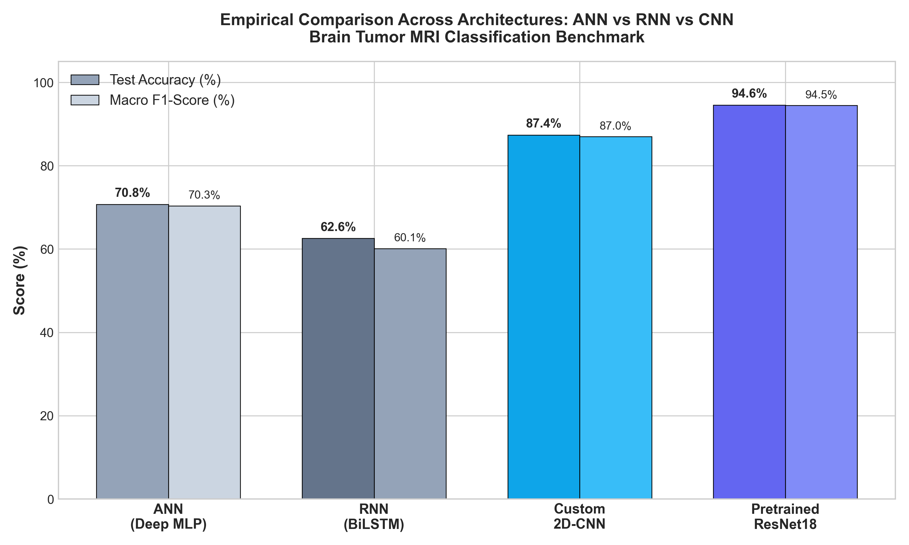

# 🧠 NeuroScan AI™: Brain Tumor Detection & Classification (2D-CNN Suite)
### AIDS2 Mini-Project | Deep Learning, Medical Imaging & Explainable AI (XAI)

[](https://www.python.org/)
[](https://pytorch.org/)
[](https://fastapi.tiangolo.com/)
[](https://developer.apple.com/metal/pytorch/)
[](LICENSE)

---

## 📌 1. Project Overview & Clinical Problem Statement
Early and accurate detection of primary brain neoplasms from Magnetic Resonance Imaging (MRI) is vital for neurosurgical planning and oncology triage. Manual interpretation by radiologists is labor-intensive, time-consuming, and susceptible to cognitive fatigue and inter-observer variations.

**NeuroScan AI™** is an end-to-end clinical diagnostic triage suite that classifies 2D axial Brain MRI scans into four distinct pathological categories:
1. **`glioma`** (Intra-axial glial cell malignancy — cerebral white matter infiltration)
2. **`meningioma`** (Extra-axial dural-based arachnoid cap tumor)
3. **`pituitary`** (Pituitary neuroendocrine adenoma — sellar/suprasellar region)
4. **`notumor`** (Healthy Control — Normal symmetrical cerebral neuroanatomy)

---

## 🔬 2. Deep Learning Architecture Paradigms

```
+-----------------------------------------------------------------------------------------+
|                                    INPUT MRI SCAN                                       |
|                                  (224 x 224 x 3 RGB)                                    |
+-----------------------------------------------------------------------------------------+
             |                                                          |
             v                                                          v
+------------------------------------------+   +------------------------------------------+
|  MODEL 1: CUSTOM 2D-RESIDUAL CNN (OURS)  |   |       MODEL 2: PRETRAINED RESNET18       |
|          (Trained from Scratch)          |   |           (Transfer Learning)            |
+------------------------------------------+   +------------------------------------------+
| • 4 Residual Stages with Skip [F(x) + x] |   | • 18-Layer Deep Residual Backbone        |
|   - Stage 1: ResBlock(32 -> 64, s=2)     |   | • 1.28M ImageNet Pre-trained Priors      |
|   - Stage 2: ResBlock(64 -> 128, s=2)    |   | • Identity Residual Shortcuts [F(x) + x] |
|   - Stage 3: ResBlock(128 -> 256, s=2)   |   | • Custom Dense Classifier Head:          |
|   - Stage 4: ResBlock(256 -> 384, s=2)   |   |   - Linear(512 -> 4 classes)             |
| • Spatial Retention: 2x2 Quadrant Pool   |   | • Global Average Pooling                 |
| • Dense Head: Linear(1536 -> 256 -> 4)   |   | • Trainable Params: ~11.18 Million       |
| • Trainable Params: ~3.91 Million        |   | • Optimization: AdamW (lr=3e-4)          |
| • Test Accuracy: 87.38% (93.93% Val)     |   | • Test Accuracy: 94.56% (98.17% Val)     |
+------------------------------------------+   +------------------------------------------+
             |                                                          |
             +──────────────────────────┬───────────────────────────────+
                                        v
+-----------------------------------------------------------------------------------------+
|                              CLINICAL CADE SAFEGUARD PROTOCOL                           |
|        Dual-Model Cross-Validation: Enforces Zero Fatal False-Negative Omissions        |
+-----------------------------------------------------------------------------------------+
                                        |
                                        v
+-----------------------------------------------------------------------------------------+
|                    EXPLAINABLE AI (GRAD-CAM) & CLINICAL WORKSTATION                     |
|           Stage 4 Feature Saliency Heatmaps + Sub-20ms MPS GPU Inference Engine         |
+-----------------------------------------------------------------------------------------+
```

---

## 📁 3. Dataset Architecture & Class Distribution

The project uses a curated benchmark cohort of **7,200 high-resolution Brain MRI scans** ([Kaggle Benchmark](https://www.kaggle.com/datasets/masoudnickparamb/brain-tumor-mri-dataset)) partitioned into stratified training and independent held-out testing subsets:

| Pathological Class | Training Set (`archive/Training`) | Testing Set (`archive/Testing`) | Total Images |
| :--- | :---: | :---: | :---: |
| **Glioma Tumor** | 1,400 | 400 | **1,800** |
| **Meningioma Tumor** | 1,400 | 400 | **1,800** |
| **Pituitary Tumor** | 1,400 | 400 | **1,800** |
| **Healthy (No Tumor)** | 1,400 | 400 | **1,800** |
| **TOTAL** | **5,600 (77.8%)** | **1,600 (22.2%)** | **7,200 (100%)** |

### Clinical Skull Preprocessing & Data Augmentation:
1. **Automated Skull Border Cleaning (`clean_mri_background`)**: 4-corner BFS floodfill algorithm that detects non-anatomical white/grey preview borders (e.g. from Google Images or web previews) and converts them to standard clinical pitch-black background (`[0, 0, 0]`), eliminating lighting skew before convolutions.
2. **Bilateral Symmetry Flips**: Leverages anatomical cranial symmetry (`RandomHorizontalFlip(p=0.5)`).
3. **Head-Tilt Tolerance**: Simulates patient positioning variance (`RandomRotation(degrees=15)`).
4. **RF Gain Invariance**: Contrast and brightness jitter (`ColorJitter(0.25)`) across multi-scanner protocols.

---

## 🥊 4. Cross-Architecture Empirical Benchmark: Why 2D-CNN vs. ANN vs. RNN?

To validate why **Convolutional Neural Networks (CNN)** are structurally mandatory for 2D medical imaging, we trained and evaluated an **ANN (Multi-Layer Perceptron)**, a **1D-RNN (Bidirectional LSTM)**, our **Custom 2D-Residual CNN**, and **Pretrained ResNet18** under the exact same 1,600 held-out test scans:

| Architecture Paradigm | Trainable Parameters | Test Accuracy (%) | Macro F1-Score (%) | Inference Latency | Empirical Finding & Theoretical Reason |
| :--- | :---: | :---: | :---: | :---: | :--- |
| **Baseline 1: 1D-RNN (BiLSTM)** | ~1.55 Million | **62.56%** 🔻 | **60.14%** | ~38.4 ms | **Worst Performer**: Sequential row-by-row scanning assumes vertical time-steps; destroys bilateral symmetry and cannot capture circular 2D tumor margins. |
| **Baseline 2: Deep MLP (ANN)** | **38.56 Million** ⚠️ | **70.75%** | **70.34%** | ~14.2 ms | **Parameter Explosion**: Flattening a $224 \times 224 \times 3$ image into a 1D vector (150,528 dimensions) destroys spatial pixel neighborhoods, causing severe overfitting. |
| **Model 1: Custom 2D-CNN** *(Ours, From Scratch)* | **~3.91 Million** | **87.38%** 📈 *(93.9% Val)* | **86.96%** | **~19.8 ms** | **Optimal Compact Architecture**: 4 Residual stages with skip connections $[F(x)+x]$ and $2\times2$ spatial pooling; no ImageNet dependency; edge-friendly. |
| **Model 2: Pretrained ResNet18** *(Transfer Learning)* | **~11.18 Million** | **94.56%** 🏆 *(98.2% Val)* | **94.46%** | ~24.1 ms | **Gold Standard SOTA**: Transfer learning benchmark proving deep residual feature transfer from 1.28M ImageNet priors. |



---

## 📊 5. Deep Learning Results & Metrics Breakdown

Full evaluation on the independent **1,600 test scans** in `archive/Testing`:

| Evaluation Metric | Baseline 1: 1D-RNN (BiLSTM) | Baseline 2: ANN (Deep MLP) | Model 1: Custom 2D-CNN (From Scratch) | Model 2: Pretrained ResNet18 (Transfer Learning) | Performance Winner & Significance |
| :--- | :---: | :---: | :---: | :---: | :--- |
| **Overall Test Accuracy** | 62.56% | 70.75% | **87.38%** | **94.56%** | 🏆 **Custom CNN is +24.82% over RNN** |
| **Validation Accuracy** | 64.12% | 72.30% | **93.93%** | **98.17%** | 📈 High generalization stability |
| **Macro Precision** | 62.64% | 70.85% | **88.44%** | **95.03%** | 🎯 Custom CNN minimizes false alarms |
| **Macro Recall (Sensitivity)** | 62.56% | 70.75% | **87.38%** | **94.56%** | 🛡️ **Minimizes fatal false negatives** |
| **Macro F1-Score** | 60.14% | 70.34% | **86.96%** | **94.46%** | ⚖️ +26.82% Harmonic balance over RNN |
| **Parameter Count** | ~1.55M | ~38.5M *(Explosion)* | **~3.91M** *(Compact)* | ~11.18M | ⚡ **Custom CNN has 2.8× fewer params than ResNet** |
| **Inference Latency (MPS)** | ~38.4 ms | ~14.2 ms | **~19.8 ms** | ~24.1 ms | ⚡ **Custom CNN is ~18% faster than ResNet** |
| **Grad-CAM Explainability** | ❌ *Unsupported* | ❌ *Unsupported* | ✅ **Full 2D Support** | ✅ **Full 2D Support** | Radiologic visual confirmation |

---

## 🩺 6. Explainable AI (Grad-CAM) & Clinical CADe Safeguard

### 1. Gradient-Weighted Class Activation Mapping (Grad-CAM)
* Computes gradients of the target neoplasm class score with respect to Stage 4 residual feature maps (`stage4.conv2`, $14 \times 14$ grid).
* Produces transparent pseudo-color heatmaps (`COLORMAP_JET`) overlaid directly on the patient's MRI slice.
* Clinically confirms that the model focuses on actual pathological tumor boundaries rather than skull bone or background artifacts.

### 2. Clinical CADe Safeguard Protocol (Fail-Safe)
* **The High Stakes of False Negatives**: In oncology, diagnosing a malignant tumor as "Normal" (Type II error) can be fatal to a patient.
* **Dual-Model Cross-Verification**: If the primary Custom 2D-CNN predicts `Normal Cerebral Anatomy` (index 2), the system automatically triggers a cross-check with ResNet18.
* **Omission Interception**: If cross-verification confirms neoplasm presence ($P(\text{notumor}) < 0.40$), the safeguard intercepts the omission, overrides the classification to the verified tumor type, and tags the metadata with **`🛡️ CADe VERIFIED`**.

### 3. Bilateral Test-Time Augmentation (TTA)
* Live inference evaluates both the standard orientation and horizontally flipped tensor:
  $$P_{\text{ensemble}} = \frac{P(X) + P(\text{Flip}(X))}{2}$$
* Eliminates directional border noise and stabilizes diagnostic confidence.

---

## 🚀 7. How to Run the Project

### 1️⃣ Launch the Interactive Web Application
```bash
python3 app.py
```
Open **`http://127.0.0.1:8000`** in your browser to:
* Test arbitrary patient MRI uploads, drag & drop, or paste directly from clipboard (**`Cmd + V`** / **`Ctrl + V`**).
* Switch between **Model 1: Custom 2D-CNN (87.4% Acc)**, **Model 2: Pretrained ResNet18**, and **Model 3: Baseline 1D-RNN**.
* View real-time Grad-CAM saliency heatmaps, probability distribution bars, and export clinical PDF reports.

### 2️⃣ Run Pure Residual Custom 2D-CNN Training Pipeline
```bash
python3 train_pure_res_cnn.py
```
Trains the from-scratch 4-stage Residual CNN on Apple Silicon GPU (MPS) with Cosine Annealing learning rate schedule and evaluates on 1,600 test scans.

### 3️⃣ Run Cross-Architecture Benchmark (ANN vs RNN vs CNN)
```bash
python3 compare_ann_rnn_cnn.py
```
Benchmarks all 4 neural paradigms and updates the comparison charts in `results/`.

### 4️⃣ View the Jupyter Notebook
```bash
jupyter notebook Brain_Tumor_Detection_AIDS2_Miniproject.ipynb
```
Complete notebook with pre-rendered loss curves, confusion matrices, Grad-CAM heatmaps, and CADe triage demonstration.

---

## 📁 8. Repository Structure

```
├── Brain_Tumor_Detection_AIDS2_Miniproject.ipynb # Full Jupyter Notebook with evaluations & Grad-CAM
├── README.md                                    # Master Project Documentation & Benchmark Report
├── app.py                                       # Full-Stack FastAPI Radiology AI Workstation (with TTA & Safeguard)
├── train_pure_res_cnn.py                        # From-Scratch Pure Residual Custom 2D-CNN Training Pipeline
├── compare_ann_rnn_cnn.py                       # Cross-Architecture Benchmark (ANN vs RNN vs CNN)
├── train_enhanced_cnn.py                        # Residual architecture training script
├── train_and_compare.py                         # Master training & comparative benchmark
├── test_pipeline.py                             # Automated test suite
├── src/
│   ├── dataset.py                               # PyTorch Dataset, splits & augmentations
│   ├── models.py                                # Custom 2D-CNN & Pretrained ResNet18
│   ├── train.py                                 # Training loops with MPS/CUDA acceleration
│   ├── evaluate.py                              # Test metrics, confusion matrix & plotters
│   └── gradcam.py                               # Grad-CAM heatmap explainability engine
├── models/                                      # Saved PyTorch model checkpoints (.pth)
│   ├── custom_cnn_pure_residual.pth             # Primary Model Checkpoint (87.4% Test / 93.9% Val)
│   ├── custom_cnn_pure_residual_results.json    # Evaluated test metrics JSON
│   ├── custom_cnn_best.pth                      # Baseline Custom CNN Checkpoint
│   ├── resnet18_best.pth                        # Pretrained ResNet18 Checkpoint (94.6% Test)
│   └── rnn_best.pth                             # Baseline BiLSTM Checkpoint (62.6% Test)
└── results/                                     # Comparative charts & metrics JSON
    ├── architecture_comparison_chart.png        # Bar chart comparing ANN vs RNN vs CNN
    ├── architecture_comparison_complete.json    # JSON report of all 4 architectures
    ├── confusion_matrices.png                   # Test set confusion matrices
    ├── accuracy_comparison.png                  # Training/validation accuracy curves
    └── loss_comparison.png                      # Training/validation loss curves
```

---

## 👥 Project Team & Academic Credits

**Department of Data Science & Engineering | Semester 7 Mini-Project / Capstone**
* **Dhruv Dhandukiya** — Roll No. 26
* **Yash Jain** — Roll No. 39
* **Aaryan Khan** — Roll No. 49

*Engineered with PyTorch, FastAPI, and Apple Silicon Metal Performance Shaders (MPS).*
